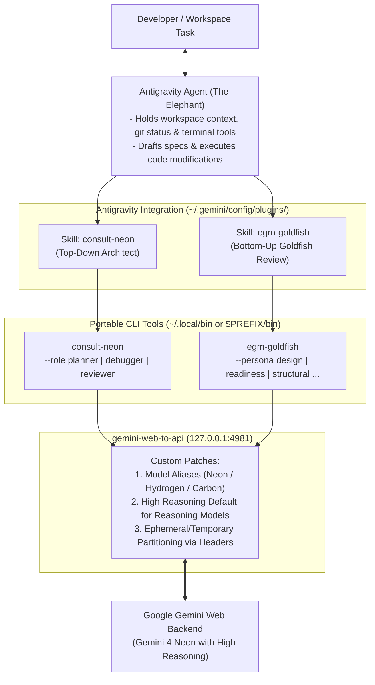

# Feature Specification: Antigravity Neon Orchestrator & EGM Bridge

## 1. Problem Statement & Motivation
Developers with consumer Google AI Pro or Google One AI subscriptions (including regional partnership bundles like Reliance Jio in India) receive full web access on `gemini.google.com` to Google's frontier Gemini 4 line-up (Gemini 4 Neon, Hydrogen, Carbon). However, in Google Antigravity, enterprise cloud entitlement checks mark all Gemini 4 series models as `[Unavailable]`, leaving developers restricted to smaller models (e.g., Gemini 3.8 Flash) or third-party APIs.

This forces developers to manually copy-paste between the Gemini web interface and their coding workspace. Furthermore, vanilla `gemini-web-to-api` lacks automatic mapping for newly released Gemini 4 model display names (`gemini-deeper-analysis` -> `gemini-4-neon`), does not enforce necessary high-reasoning defaults, and creates a new web sidebar chat on every stateless API turn unless temporary/ephemeral execution is properly partitioned.

This specification defines a cross-platform, open-source orchestration bridge enabling any developer or Antigravity agent on Android (Termux), Linux, macOS, or Windows to utilize Gemini 4 Neon as both a **High-Reasoning Lead Architect** (Top-Down Orchestrator) and a **Stateless Goldfish Reviewer** (Bottom-Up Verification).

## 2. Goals & Non-Goals
### Goals
- **Universal Cross-Platform Tooling:** Provide portable, unprivileged CLI tools (`consult-neon`, `egm-goldfish`) and Antigravity skills that run seamlessly on Android Termux, Linux, macOS, and Windows.
- **Single-Prompt Autonomous Bootstrapping:** Enable an Antigravity agent on a brand-new machine to clone the repository and configure the entire stack autonomously via `install.py` without requiring root or `sudo`.
- **Top-Down Orchestrator Planning:** Let Antigravity consult Gemini 4 Neon as the Lead Architect to generate step-by-step implementation plans, system blueprints, and diagnose test failures.
- **Bottom-Up Elephant-Goldfish Audit Loop:** Apply Google's official EGM methodology by piping technical specs, implementation plans, and git diffs to Gemini 4 Neon cold in an isolated, stateless context with high reasoning.
- **Smart Ephemeral / Persistent Partitioning:** 
  - Goldfish audits and automated subagent queries execute in **Ephemeral Mode** (`isTemporary = true`), creating zero sidebar clutter on `gemini.google.com`.
  - Long-form architectural design sessions can optionally flag persistent storage (`--persist`) when permanent web chat records are desired.

### Non-Goals
- Bypassing Google's authentication mechanisms; users must supply their own session cookies from their authenticated personal account.
- Commercial or enterprise scale scraping; this tool is strictly a developer-focused, single-user local bridge.

## 3. System Architecture & Component Interaction

## 4. Component Details & Interface Contracts

### 4.1. The Patched `gemini-web-to-api` Engine
- **Upstream Baseline:** Pinned to `ntthanh2603/gemini-web-to-api` commit `507f5aa244a421ec2cc10a664f4ec37eb108be54` (or latest stable).
- **Binding & Security:** Listens strictly on `127.0.0.1:4981` (never `0.0.0.0`).
- **Model Resolution:** Automatically resolves `gemini-4-neon`, `neon`, and `gemini-neon` to `gemini-deeper-analysis`; `gemini-4-hydrogen` to `gemini-everyday-help`; and `gemini-4-carbon` to `gemini-code-complex-work`.
- **Reasoning Level Enforcement:** When `reasoning_effort` is omitted, defaults to `thinkingLevel = 2` (high) for reasoning models (Neon, Carbon).
- **Mode Partitioning (`WithTemporary`):**
  - Default: Inherits `GEMINI_TEMPORARY=true` (ephemeral/incognito mode, zero web sidebar clutter).
  - Explicit: Honored via `X-Temporary: true/false` request header or `X-Persist: true`.

### 4.2. `consult-neon` CLI Contract
- **Executable:** Installed to user path (`~/.local/bin` on Linux/macOS, `$PREFIX/bin` on Termux, `.cmd` shim on Windows).
- **Synopsis:** `consult-neon [OPTIONS] [PROMPT]`
- **Options:**
  - `-r, --role {planner, debugger, reviewer, general}`: Selects system persona (default: `planner`).
  - `-c, --context FILE`: Appends file context (with automatic secret redaction for `.env` / credentials).
  - `--persist`: Flags `X-Temporary: false` to retain this chat in Google Gemini web history.
  - `--json`: Enforces structured JSON output.
  - `--model MODEL`: Defaults to `gemini-4-neon`.
  - `--thinking {low, medium, high}`: Defaults to `high`.
- **Exit Codes:**
  - `0`: Success (response on stdout).
  - `1`: Validation / argument error.
  - `2`: Network / proxy unreachable on `127.0.0.1:4981`.
  - `3`: Upstream authentication / cookie expired.

### 4.3. `egm-goldfish` CLI Contract
- **Executable:** Installed to user path.
- **Synopsis:** `egm-goldfish [OPTIONS] TARGET_FILE` (or `git diff | egm-goldfish -`)
- **Options:**
  - `-p, --persona {design_critic, implementation_readiness, structural, comprehension, codebase_details, zoom_out, style, inventive_catalyst}`: Loads EGM persona.
  - `-s, --standard STANDARD_FILE`: Document standard (defaults to `feature-spec-standard.md` for design, `implementation-readiness-standard.md` for readiness).
  - `-c, --context FILE`: Supporting baseline context files.
  - `-m, --mode {REVIEW, BRAINSTORM}`: Defaults to `REVIEW`.
- **Ephemeral Rule:** Always sends `X-Temporary: true` so audits never pollute the user's web chat history.
- **Exit Codes:**
  - `0`: Audit completed with no `Blocker` findings.
  - `1`: Argument error.
  - `2`: Proxy unreachable.
  - `4`: Audit completed with one or more `Blocker` findings.

### 4.4. Universal Installer (`install.py`)
- **Unprivileged Execution:** Installs strictly into user space (`~/.local/bin` or `$PREFIX/bin`); never invokes `sudo`.
- **Cross-Platform Detection:**
  - Android Termux: Uses `termux-fix-shebang` and `$PREFIX`.
  - Linux/macOS: Adds `~/.local/bin` to user profile (`~/.bashrc`, `~/.zshrc`).
  - Windows: Creates `.cmd` batch wrappers in `%USERPROFILE%\.local\bin` or user Python Scripts directory.
- **Idempotency:** Safe to run multiple times without duplicating PATH entries or overwriting user `.env` files.
- **Plugin Registration:** Installs `consult-neon` and `egm-goldfish` skills into `~/.gemini/config/plugins/` and workspace `.agents/skills/`.

## 5. Alternatives Considered

| Alternative | Evaluation & Trade-offs | Decision |
| :--- | :--- | :--- |
| **Native MCP Server vs. Standalone CLI + Skills** | A dedicated MCP server integrates into AGY's tool schema, but lacks ease of command-line piping (e.g. `git diff \| egm-goldfish`). Standalone CLI tools provide maximum flexibility (terminal, scripts, subagents, and skills). | **Hybrid:** Provide standalone CLI tools wrapped in native Antigravity skills for best of both worlds. |
| **Browser CDP / Chrome Extension Bridge vs. Reverse-Engineered HTTP Proxy** | A Chrome extension / CDP bridge avoids TLS fingerprinting and cookie rotation, but requires a running Chromium browser GUI, which is unavailable in headless Linux servers or standard Android Termux. `gemini-web-to-api` is self-contained and runs headless. | **Selected HTTP Proxy:** Enables true headless operation across Android and servers. |
| **API Studio / Paid Pay-Per-Token Key** | Uses official API endpoints, but incurs extra per-token billing and cannot leverage consumer Google AI Pro subscription entitlements. | **Rejected:** Primary goal is leveraging the user's active consumer Google AI Pro subscription. |

## 6. Security, Operational Limits & Risks

### 6.1. Security Guardrails
- **Loopback Enforcement:** `gemini-web-to-api` binds only to `127.0.0.1`.
- **Context Secret Redaction:** `consult-neon` and `egm-goldfish` automatically block or warn when passing known secret files (e.g. `.env`, `id_rsa`, `*.pem`, `*.key`) to prevent accidental transmission of private credentials.
- **Cookie Protection:** User cookies are stored in `.env` with strict `0600` permissions and covered by `.gitignore`.

### 6.2. Operational Limits & Timeouts
- **Timeout Budget:** Frontier reasoning requests on Neon can run for 40–120 seconds. CLI tools enforce a 300-second client timeout to prevent premature socket cancellation.
- **Concurrency:** Avoid launching more than 2 concurrent Goldfish audits on a single session to prevent upstream HTTP 429 rate limiting.

### 6.3. TOS & Anti-Bot Mitigations
- Automating web frontends carries risks of HTTP 429 throttling or CAPTCHA challenges.
- **Mitigation:** The proxy implements exponential backoff on retries and automatic session token refresh. Users are advised to use a secondary or development Google account for heavy automated pipelines.

## 7. Verification & Acceptance Criteria
- [x] **Model Resolution:** `curl ... -d '{"model": "gemini-4-neon"}'` resolves to `gemini-deeper-analysis`.
- [x] **Reasoning Enforcement:** Requests to Neon without explicit `reasoning_effort` automatically execute at `thinkingLevel = 2`.
- [x] **Smart Ephemeral Partitioning:** Default requests create 0 chats on `gemini.google.com`; `--persist` creates a permanent thread.
- [x] **EGM Audit Execution:** `egm-goldfish` runs on design specs and returns structured `[Blocker | Major | Nit]` findings.
- [x] **Cross-Platform Installer:** `install.py` runs cleanly on Android Termux, Linux, macOS, and Windows.
